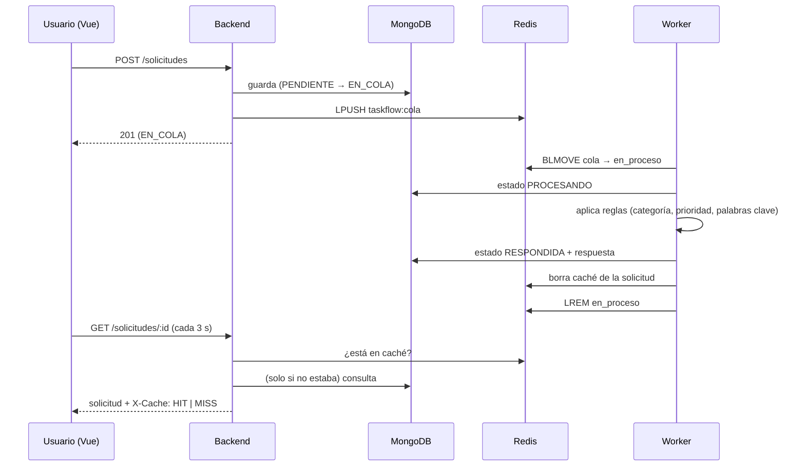

# Arquitectura de TaskFlow

TaskFlow es un sistema **distribuido**: varias piezas independientes, cada una en su propio contenedor, que colaboran por la red para atender una solicitud.

```
 Navegador ──► frontend (nginx + Vue) ──/api──► backend (Express) ──► MongoDB
                                                     │  ▲                ▲
                                          encola /   │  │ caché          │ guarda
                                          lee caché  ▼  │                │ respuesta
                                                   Redis ◄──── worker ───┘
                                                (cola + caché)  (toma la cola, aplica reglas)
```

| Servicio | Tecnología | Responsabilidad | Estado propio |
|---|---|---|---|
| `frontend` | Vue 3, Vue Router, Vite, nginx | Interfaz; reenvía `/api` al backend | No |
| `backend` | Node.js, Express, Mongoose | API REST: valida, guarda, encola, sirve lecturas con caché | No |
| `worker` | Node.js (misma imagen del backend) | Toma solicitudes de la cola, genera la respuesta y la guarda | No |
| `mongo` | MongoDB 7 | Fuente de verdad: solicitudes y respuestas | Sí (volumen `mongo-data`) |
| `redis` | Redis 7 (AOF activado) | Cola de trabajo y caché de lecturas | Sí (volumen `redis-data`) |

## Principios de una arquitectura distribuida que aplica

1. **Separación de responsabilidades.** Cada servicio hace una cosa. El backend no genera respuestas y el worker no atiende HTTP.
2. **Procesamiento asíncrono.** `POST /solicitudes` responde en milisegundos con `201`; el trabajo pesado ocurre después, en el worker. El usuario ve el avance (EN_COLA → PROCESANDO → RESPONDIDA) sin quedarse esperando.
3. **Desacoplamiento mediante una cola.** Backend y worker no se conocen: solo comparten la cola en Redis. Si el worker se detiene, las solicitudes esperan; si el backend se detiene, el worker sigue vaciando la cola.
4. **Servicios sin estado.** Backend y worker no guardan nada en su disco ni en su memoria que importe. Todo el estado vive en MongoDB y Redis, por eso se pueden reiniciar o reemplazar sin perder datos.
5. **Tolerancia a fallos.** Si Redis cae, la API sigue aceptando solicitudes (quedan `PENDIENTE`) y sirve lecturas directo desde MongoDB. El worker las reencola cuando Redis vuelve.
6. **Consistencia eventual.** Entre que el worker guarda la respuesta y la interfaz la muestra pasan unos segundos. Es aceptable y se acota con la invalidación de caché y el TTL.
7. **Descubrimiento por nombre.** Los servicios se encuentran por el nombre de Compose (`mongo`, `redis`, `backend`), no por IP.

## Flujo de una solicitud



Estados: `PENDIENTE` (guardada, aún sin cola) → `EN_COLA` → `PROCESANDO` → `RESPONDIDA` o `ERROR`.

## Redis: dos usos

### Cola confiable
- El backend hace `LPUSH taskflow:cola <id>`.
- El worker hace `BLMOVE taskflow:cola taskflow:en_proceso RIGHT LEFT`: toma la más antigua **y** la anota como "en proceso" en un solo paso atómico.
- Al terminar (RESPONDIDA o ERROR) la quita de `en_proceso` con `LREM`.
- Si el worker muere a mitad, el id queda en `en_proceso`. Al arrancar, el worker devuelve esos ids a la cola **y** pasa su estado de `PROCESANDO` a `EN_COLA` (sin esto el id volvería a la cola pero el worker lo descartaría).
- Garantía: **al menos una vez**. Una solicitud puede intentarse dos veces tras una caída, pero nunca se pierde. El procesamiento es seguro de repetir porque solo toma solicitudes en `EN_COLA`/`PENDIENTE` y la respuesta es determinista.
- Redis corre con `appendonly yes`: la cola sobrevive a un reinicio del contenedor.

### Caché de lecturas (cache-aside)
- `GET /solicitudes/:id` y `GET /solicitudes` buscan primero en Redis. Si no están, consultan MongoDB y guardan el resultado.
- La respuesta incluye la cabecera `X-Cache: HIT | MISS | BYPASS` (BYPASS: Redis no disponible).
- **Invalidación:** cada vez que una solicitud cambia (backend al crearla, worker al pasar de estado) se borra su clave y se incrementa una "versión" de los listados, lo que deja inservibles los listados anteriores.
- **TTL:** 60 s para solicitudes terminadas (ya no cambian) y 5 s para las que están en curso. El TTL corto acota el caso raro en que una lectura rezagada guarde un dato viejo justo después de una invalidación.
- `GET /metricas` expone aciertos, fallos y tasa de aciertos.

## Decisiones y límites conocidos

- **Orden al crear:** se marca `EN_COLA` *antes* de encolar. Si fuera al revés, un worker veloz podría pasar la solicitud a `PROCESANDO` y el backend la pisaría con `EN_COLA`.
- **Un solo worker.** La recuperación al arrancar mueve *todo* lo que haya en `en_proceso`. Con varios workers simultáneos habría que dar a cada uno su propia lista de "en proceso" (`en_proceso:<id-worker>`). Para esta práctica, un worker basta y mantiene el diseño simple.
- **Seguridad básica:** el backend solo acepta textos (evita inyección NoSQL con objetos), escapa la búsqueda y el contenedor corre con el usuario `node`. Mongo y Redis se publican solo en `127.0.0.1`. No hay autenticación de usuarios: está fuera del alcance.
- **Respuestas por reglas, no por IA:** el motor (`reglas.service.js`) es una función pura basada en tablas. Es predecible, gratuito y fácil de probar.
